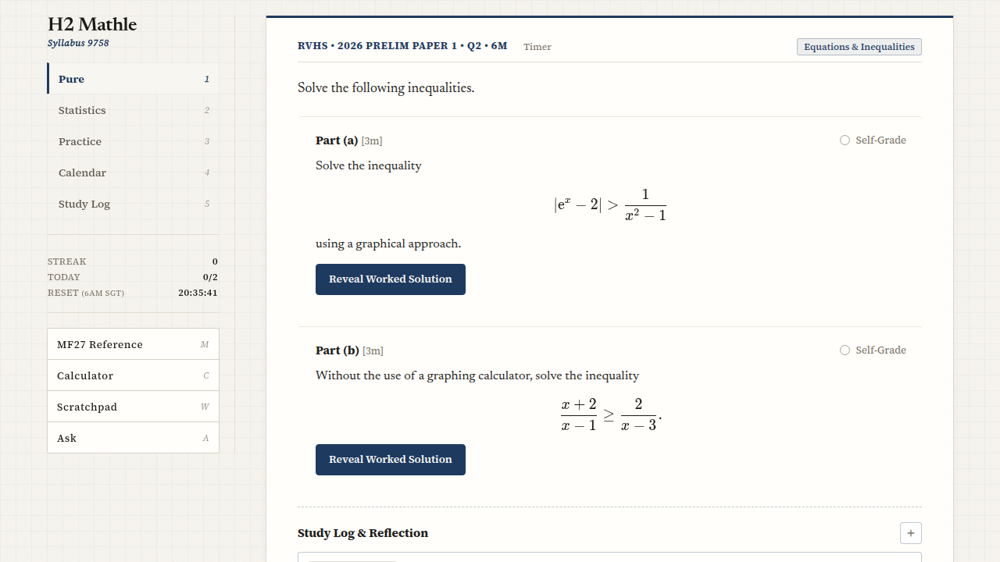

# H2 Mathle

An offline-first daily practice web app for Singapore A-Level H2 Mathematics (9758) prelim questions. It runs as plain HTML, CSS, and JavaScript with no build step or backend, and stores everything locally in your browser.

Live app: www.h2mathle.com

## Features

Daily practice resets at 6:00 AM SGT and gives 1 Pure and 1 Statistics question from a bank of 727 questions (523 Pure, 204 Statistics). Questions follow a deterministic daily cycle, so everyone gets the same questions on a given day with no repeats until a full cycle finishes.

The Calendar tab tracks daily completion (`0/2`), streaks, and monthly history using `Done`, `Partially Complete`, and `Incomplete` states so finishing a question still counts even if you got parts wrong. You can also export and restore your progress as a `.json` file.

For typing answers, the app uses a WYSIWYG math input styled with Computer Modern (`KaTeX_Main` and `KaTeX_Math`), an inline SVG radical while typing, and full KaTeX rendering once you click away or submit. It supports keyboard shortcuts (`sqrt`, `pi`, `pm`, `theta`, `arctan`, `^`, `/`) and a math keypad with inverse trig buttons (`sin⁻¹`, `cos⁻¹`, `tan⁻¹`). The built-in offline grader checks exact forms, 3 s.f. (and accurate 4+ s.f.), decimal places, complex numbers, lists, tuples, algebraic expressions (including inverse and reciprocal trig), and antiderivatives (`+ c`), with a MathML fallback when offline.

Hovering over the pin dot on any question part reveals a flag icon to bookmark that part. In the Study Log tab, an expandable Flagged Questions panel at the top lists your flagged questions with topic labels, sorting (`Date: Newest`, `Date: Oldest`, `Topic`, `School`), and quick unflagging. Opening a question from this panel starts Focus Mode, which greys out unflagged parts with their reference answers shown so the preamble and flagged parts stand out.

Below the flagged panel, the Study Log lets you keep multiple reflection entries per question, tag each entry to a specific part (`All`, `(a)`, `(b)`, and so on), and label errors (`GC Error`, `Algebra Slip`, `Conceptual Gap`, etc.). Notes support inline `$...$` and display `$$...$$` LaTeX with automatic `$` pairing, live preview while typing, and inline editing or deletion directly from the Study Log tab.

The Practice tab organizes the bank into 18 Syllabus 9758 topics grouped under Pure Mathematics and Probability & Statistics. You can filter by topic, school, and status (`Unseen`, `Missed`, `Solved`), or jump straight to any question, and changing a filter rolls a random matching question automatically. A two-step `Mark as Solved` confirmation tracks your progress per topic with a live solved counter, saved locally and included in JSON backups. If a question overlaps with the daily cycle, Practice notes when it appeared as a daily question, and the Daily tabs note when you have already marked it solved in Practice.

A few extra study tools stay hidden until you open them:

- MF27 (`M`): searchable formula reference drawer.
- Calculator (`C`): built-in graphing calculator drawer with five tabs: Stats (Normal CDF, `invNorm`, Binomial, 1-sample Z-Test and T-Test, 1-Var stats, and `LinReg` with non-linear transforms), Calc (scientific tape with `nCr`, `nPr`, `!`, `Ans`, and `RAD`/`DEG`), Solve (2x2 to 4x4 simultaneous equations and degree 2 to 4 real or complex polynomial roots), Calculus (`fnInt` and `nDeriv`), and Graph (interactive `Y1`/`Y2` plotter with trace, Zeros, and Intersect).
- Scratchpad (`W`): floating vector whiteboard with a whole-stroke eraser, pan (`Space+drag`, middle-click, or two-finger drag), zoom, grid toggle, `Ctrl+Z` undo, and part pinning.
- Ask (`A`): copies the current question, official solution, and any pinned parts along with your prompt to the clipboard and opens Gemini in a new tab.
- Stopwatch: optional per-question timer in the question header.

## Project structure

- `index.html`: app shell, Newsreader, Source Serif 4, and KaTeX links, and drawers.
- `styles.css`: Exam Folio Prussian Navy styling, 20px graph-grid paper backdrop, responsive rail layout, math-field styling, and drawer styles.
- `app.js`: WYSIWYG math field, offline grader, daily scheduler, Practice tracking, Study Log, Scratchpad, and Ask drawer.
- `gc.js`: standalone built-in calculator engine and drawer (distributions, hypothesis tests, regression, linear and polynomial solvers, numerical calculus, and graph canvas).
- `questions.js`: question registry (`window.registerQuestions`).
- `banks/manifest.js`, `banks/2025/*.js`, and `banks/2026/*.js`: 2025 and 2026 JC prelim question banks (64 papers, 727 questions).
- `PROMPT-GUIDE.MD`: LLM prompt template for converting past-paper PDFs into question bank `.js` files.
- `sw.js`: network-first Service Worker with offline cache fallback.

## Adding question banks

1. Give an LLM the instructions in [PROMPT-GUIDE.MD](PROMPT-GUIDE.MD) along with your past-paper PDF to convert the questions into the `.js` format used in `banks/`.
2. Save the generated file under `banks/<year>/` (for example, `banks/2026/my-paper.js`).
3. Add the new file path to `banks/manifest.js` so `loadBankScripts()` loads it automatically.

## Usage

Open `index.html` directly in a browser, or host the folder over HTTP/HTTPS (such as GitHub Pages, Cloudflare Pages, or Netlify) to enable Service Worker offline caching.

### Keyboard shortcuts

- `1` to `5`: switch tabs (`Pure`, `Statistics`, `Practice`, `Calendar`, `Study Log`)
- `M`: toggle MF27 reference
- `C`: toggle Calculator
- `W`: toggle Scratchpad
- `A`: toggle Ask drawer
- `Esc`: close open drawer

## Notes

All daily progress, Practice solved markers, study log entries, and flagged parts stay in your browser's `localStorage`.

## License

The application code is licensed under the [GNU AGPLv3](LICENSE). You can use or modify it as long as you give credit and release any modified or hosted version under the same license. This license covers the app code only; the prelim questions in `banks/` belong to their respective schools and are included for personal study.
